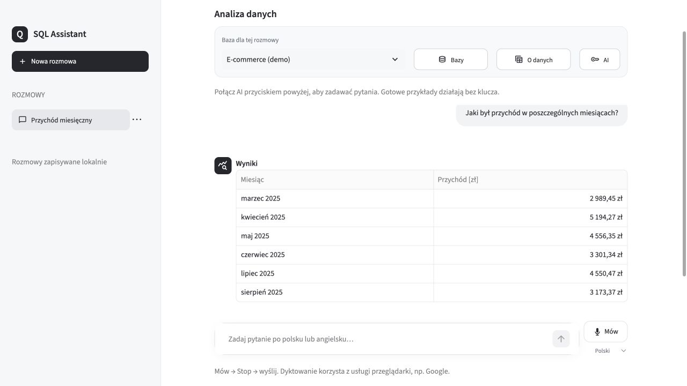
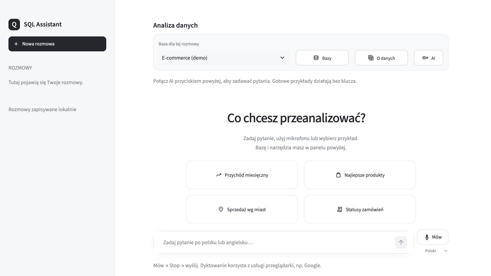
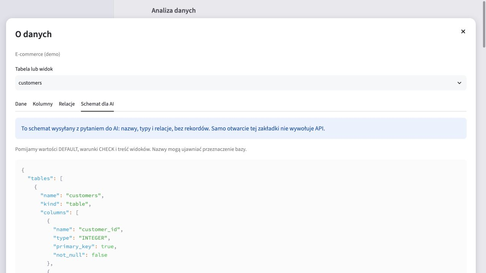
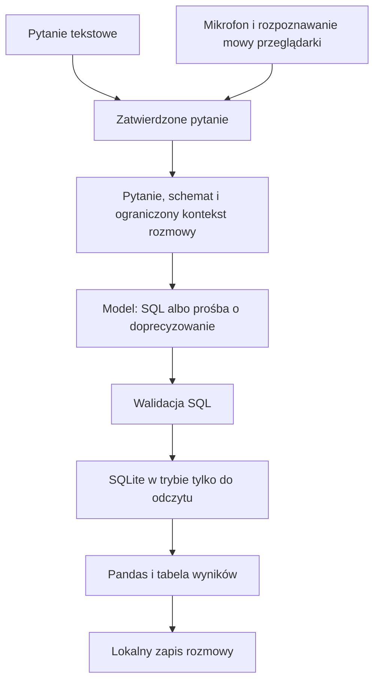

# Voice & Text-to-SQL Analytics Assistant

[](https://github.com/KacperOkrasa/voice-text-to-sql-assistant/actions/workflows/tests.yml)

Lokalna aplikacja do zadawania pytań o dane SQLite po polsku i angielsku.
Użytkownik wpisuje lub dyktuje pytanie, a aplikacja generuje SQL, sprawdza
uprawnienia zapytania i prezentuje wynik w tabeli. Kolejne wiadomości mogą
kontynuować analizę, np. „A tylko we wrześniu?”.

Projekt portfolio pokazujący pracę z Pythonem, relacyjnymi danymi, integracją API,
walidacją SQL oraz testami logiki i interfejsu. Dane demonstracyjne są syntetyczne.

**Technologie:** Python · SQLite · Pandas · Streamlit · OpenAI SDK · JavaScript / Web Speech API.

> **Rekordy z tabel nie są wysyłane do modelu generującego SQL.**
> Aplikacja przekazuje strukturę bazy: nazwy tabel i kolumn, typy danych oraz
> relacje — wraz z pytaniem i ograniczonym kontekstem rozmowy. Zapytanie SQL
> wykonuje lokalnie, a otrzymane wyniki pozostają na komputerze.
> To nie oznacza anonimizacji: informacje wpisane w pytaniu lub zawarte w nazwach
> obiektów również trafiają do modelu. [Szczegóły prywatności](#prywatność-i-zabezpieczenia).



*Rzeczywisty interfejs aplikacji. Na zrzucie działa wbudowany przykład bez klucza API;
nie jest to demonstracja odpowiedzi wygenerowanej przez model.*

<details>
<summary>Więcej zrzutów: ekran startowy i schemat dla AI</summary>





Zrzuty wykonano w czystej instalacji na danych syntetycznych.
[Opis ich odtworzenia](docs/SCREENSHOTS.md).

</details>

[Uruchomienie](#szybki-start) · [Architektura](#jak-to-działa) ·
[Prywatność](#prywatność-i-zabezpieczenia) · [Testy](#testy) · [Plan prac](docs/ROADMAP.md)

## Co potrafi aplikacja

- Generuje zapytania SQL na podstawie pytania i schematu wybranej bazy.
- Dopytuje o niejasne pytanie i przyjmuje krótką odpowiedź bez powtarzania całej treści.
- Pozwala kontynuować ostatnią analizę w ramach tej samej rozmowy.
- Dyktuje tekst na żywo do pola wiadomości; użytkownik sprawdza go przed wysłaniem.
- Przyjmuje własne pliki SQLite i pokazuje tabele, kolumny oraz relacje.
- Zapisuje rozmowy i wyniki lokalnie, odtwarzając je bez ponownego wywołania modelu.
- Udostępnia tabelę wyników, zwijany podgląd SQL, kopiowanie kodu i eksport CSV.
- Po wybranych błędach SQLite podejmuje jedną próbę poprawy zapytania przez model.
- Zawiera gotowe analizy e-commerce działające bez klucza API.

Interfejs służy do pytań w zwykłym języku. Nie ma edytora SQL ani importu plików
`.sql`. Rozpoznany kod SQL wpisany w czacie jest odrzucany lokalnie.

## Szybki start

Wymagania: **Python 3.12** (wersja używana do lokalnej weryfikacji).
SQLite jest częścią standardowej biblioteki Pythona i nie wymaga osobnego serwera.
Pobierz repozytorium i przejdź do katalogu projektu:

```bash
git clone https://github.com/KacperOkrasa/voice-text-to-sql-assistant.git
cd voice-text-to-sql-assistant
```

Dalsze polecenia wykonuj w tym katalogu.

```bash
python -m venv .venv
```

Aktywuj środowisko na macOS/Linux:

```bash
source .venv/bin/activate
```

Lub w Windows PowerShell:

```powershell
.venv\Scripts\Activate.ps1
```

Zainstaluj zależności i uruchom aplikację:

```bash
python -m pip install -r requirements.txt
python -m streamlit run app.py --server.address 127.0.0.1 --server.port 8502
```

Otwórz [http://127.0.0.1:8502](http://127.0.0.1:8502).
Baza e-commerce powstanie automatycznie przy pierwszym uruchomieniu.
Bez klucza API można przeglądać dane i uruchamiać gotowe przykłady.

### Włączenie pytań do AI

Skopiuj `.env.example` do `.env` i uzupełnij go **lokalnie**:

```dotenv
OPENAI_API_KEY=twoj_klucz
OPENAI_SQL_MODEL=gpt-6-luna
```

To ustawienie modelu używane w projekcie; konto API musi mieć do niego dostęp.
Pytania korzystają z endpointu `/v1/responses`. Dodatkowa transkrypcja nagrania
przez Whisper wymaga dostępu do `/v1/audio/transcriptions`.

Klucza nie wpisuj do repozytorium, `.env.example`, zrzutów ekranu ani rozmów.
`.env` jest objęty `.gitignore`. Zmienne środowiskowe mają pierwszeństwo przed
plikiem `.env`. Użycie API jest płatne; wskazania kosztu w aplikacji są szacunkowe,
nie stanowią limitu wydatków ani salda konta.

## Przykładowa rozmowa

Dla bazy **Rowerownia** wysyłaj kolejno:

> Pokaż przychód z wypożyczeń w każdym miesiącu.
>
> A tylko we wrześniu?
>
> Dodaj jeszcze liczbę wypożyczeń.
>
> Rozbij to według typu roweru.

Dla domyślnego zestawu Rowerownia przychód we wrześniu 2026 wynosi **852,00 zł**
z **50 wypożyczeń**. Pozostałe odpowiedzi kontrolne znajdują się w dokumentacji danych.
Dla e-commerce pierwszym pytaniem może być „Ile jest zamówień?” — wynik to **60**.

## Dane demonstracyjne

| Zestaw | Zawartość | Uruchomienie |
| --- | --- | --- |
| E-commerce | 20 klientów, 12 produktów, 60 zamówień i ich pozycje | Automatycznie przy starcie aplikacji |
| Rowerownia | 6 stacji, 40 klientów, 24 rowery, 240 wypożyczeń i 18 napraw | Generator, następnie import w aplikacji |

Aby utworzyć Rowerownię:

```bash
python -m data.seed_bike_rental
```

Wybierz **Bazy → Dodaj bazę** i wgraj `data/rowerownia.db`.
Generatory używają stałego ziarna losowości i nie nadpisują istniejących baz.
Wygenerowane pliki baz nie są przeznaczone do publikacji w repozytorium.

- [Opis Rowerowni i podstawowe odpowiedzi kontrolne](data/ROWEROWNIA.md)
- [10 trudniejszych pytań z odpowiedziami i SQL](data/ROWEROWNIA_TESTY_11_20.md)
- [Zapytania referencyjne](data/rowerownia_examples.sql)
- [Przychód pomniejszony o koszty serwisu](data/rowerownia_monthly_balance.sql)

Kwoty w danych demo przechowywane są w groszach. Przychód i koszty serwisu należy
agregować oddzielnie przed połączeniem: bezpośredni JOIN wielu wypożyczeń z wieloma
naprawami może zwielokrotnić sumy. To jeden z przypadków objętych testami kontrolnymi.

## Jak to działa



Model nie wykonuje SQL. Aplikacja wykonuje je lokalnie po walidacji. Wybrane błędy
składni lub nazw obiektów pozwalają na jedną poprawkę przez model; poprawione
zapytanie przechodzi ponowną kontrolę. Przekroczenie czasu i blokada bezpieczeństwa
nie uruchamiają naprawy. Błąd API można ponowić ręcznie.

### Organizacja kodu

| Plik / katalog | Odpowiedzialność |
| --- | --- |
| `app.py` | Interfejs, nawigacja i obsługa rozmowy |
| `src/ai.py` | Generowanie i poprawianie SQL, transkrypcja, obsługa API |
| `src/analysis.py` | Przebieg analizy, doprecyzowania i kontekst |
| `src/db.py` | Połączenia, metadane i odczyt SQLite |
| `src/security.py` | Walidacja SQL, filtr wejścia i autoryzator SQLite |
| `src/storage.py` | Zapis rozmów, wyników i rejestru baz |
| `src/uploads.py` | Import lokalnych kopii baz |
| `src/presentation.py` | Etykiety, formatowanie i dwa warianty eksportu CSV |
| `src/results.py` | Dokładna konwersja wartości i limity wyników |
| `src/audio.py`, `src/dictation.py` | Walidacja audio i zdarzenia dyktowania |
| `assets/` | Style i przeglądarkowy komponent mikrofonu |
| `data/` | Generatory danych i zapytania kontrolne |
| `tests/` | Testy Python oraz komponentu JavaScript |

## Prywatność i zabezpieczenia

**Model generuje SQL na podstawie struktury bazy. Nie otrzymuje tabel z rekordami
ani tabeli wynikowej.** Odczyt wartości i obliczenia wykonuje lokalny SQLite.
Aplikacja nie prosi modelu o podsumowanie zwróconych wierszy.

| Informacja | Czy aplikacja dołącza ją do żądania generowania SQL? |
| --- | --- |
| Nazwy tabel/widoków i kolumn, typy, klucze i relacje | Tak |
| Pytanie użytkownika | Tak |
| Poprzednie pytanie i SQL lub krótkie doprecyzowania | Tak, jako ograniczony kontekst tej rozmowy |
| Data odniesienia i stałe definicje biznesowe demo | Tak |
| SQL do poprawy i ogólna kategoria błędu | Tylko przy próbie naprawy |
| Plik bazy SQLite | Nie |
| Rekordy i próbki wartości z tabel | Nie |
| Wynik zapytania / DataFrame | Nie |
| Wartości DEFAULT, wyrażenia CHECK i definicje widoków | Nie |

To zachowanie wynika z jawnej listy pól żądania w [src/ai.py](src/ai.py) oraz
budowania schematu w [src/db.py](src/db.py). [Testy prywatności](tests/test_ai.py)
przechwytują żądanie do atrapy API i sprawdzają, czy nie zawiera kontrolnych
wartości z rekordów ani pomijanych definicji schematu.

**Granice tej deklaracji:** jeśli sam wpiszesz wartość z tabeli w pytaniu, staje
się ona częścią wysyłanego tekstu. Nazwy tabel lub kolumn mogą także ujawniać dane;
np. nazwa kolumny widoku może wynikać z literału. Aplikacja nie gwarantuje ich
anonimizacji. Opis dotyczy tego, co wysyła aplikacja — nie jest deklaracją zasad
retencji ani trenowania modeli u dostawcy API.


- Do modelu trafiają pytanie, metadane tabel i ograniczony kontekst: poprzednie
  pytanie z wygenerowanym SQL lub wymiana doprecyzowań. Naprawa otrzymuje SQL
  i ogólną kategorię błędu, bez surowego komunikatu SQLite.
- Kod budujący żądanie nie dołącza pliku bazy, rekordów ani wynikowego DataFrame.
  Schemat pomija wartości DEFAULT, wyrażenia CHECK i definicje widoków.
- Pytania i nazwy obiektów mogą zawierać poufne informacje. Ograniczenie do metadanych
  nie jest anonimizacją. Schemat można obejrzeć w **O danych → Schemat dla AI**.
- Filtr wklejonego SQL jest heurystyką, nie narzędziem wykrywania wszystkich sekretów.
  Jest zachowawczy: słowo `SELECT` może zablokować również zwykłe zdanie.
- Generowany SQL przechodzi walidację pojedynczego zapytania odczytu oraz autoryzator
  SQLite. Połączenie stosuje `mode=ro`, `query_only` i wyłącza zaufanie do schematu.
- Wynik ograniczono do 1000 wierszy, 100 kolumn, 64 KiB na komórkę i 4 MiB
  danych wyniku. BLOB jest liczony po konwersji do tekstu szesnastkowego.
  SQLite dodatkowo ogranicza rozmiar pojedynczej wartości/wiersza do 1 MiB
  i ma okresowo sprawdzany limit czasu około 5 sekund. Te mechanizmy nie stanowią
  pełnej izolacji ani twardego limitu pamięci całego procesu.
- Import wykonuje `quick_check(1)` i przygotowuje odczyt każdej tabeli/widoku
  w budżecie około 5 sekund. Nieprawidłowe pliki nie są rejestrowane.
  Obsługiwane są pliki do 50 MiB, do 1000 tabel/widoków i 100 kolumn na obiekt.
- Rozmowy i wyniki są zapisywane w `data/app_history.db`, a importowane pliki
  w `data/uploads/`. Aplikacja nie szyfruje tych plików. Usunięcie rozmowy jest trwałe.

Dyktowanie na żywo korzysta z usługi przeglądarki; głos może trafić np. do jej
dostawcy. Obsługa zależy od przeglądarki i zgody na mikrofon. Opcja **AI → Alternatywa:
transkrypcja gotowego nagrania** wysyła audio do OpenAI Whisper. W obu wariantach
użytkownik sprawdza tekst przed wysłaniem pytania. Aplikacja nie zapisuje nagrań
w historii ani na dysku.

**Zakres wdrożenia:** lokalna aplikacja dla jednej osoby. Nie ma logowania ani
izolacji danych użytkowników. Publiczny hosting wymaga osobnego przygotowania
kontroli dostępu, przechowywania danych i rozliczania API.

## Dokładność danych i eksport

Wyniki zachowują duże liczby całkowite także obok `NULL`. Historia używa
wersjonowanego formatu JSON bez zaokrąglania przez serializację Pandas.
Wartości nieskończone są zapisywane osobno od brakujących danych. Bardzo duże
liczby lub mieszane typy są wyświetlane jako tekst, aby przeglądarka ich nie
zaokrąglała; sortowanie takiej kolumny może być tekstowe.

W **SQL i eksport** dostępne są dwa warianty:

- **CSV do arkusza**: etykiety i jednostki odpowiadają tabeli; grosze są przeliczane
  na złote. Tekst przypominający formuły, długie identyfikatory i kody z zerami
  wiodącymi otrzymują apostrof ochronny. W niektórych importerach apostrof może
  być widoczny. Wbudowany eksport tabeli jest wyłączony, aby nie omijać tej obsługi.
- **Surowy CSV**: oryginalne nazwy i wartości, np. grosze w `_cents`.
  Przeznaczony do przetwarzania w kodzie; nie neutralizuje formuł arkusza.

Starsza historia jest odczytywana bez masowego przepisywania. Wadliwy albo
przekraczający nowe limity wpis wyświetla komunikat zamiast blokować rozmowę;
oryginalny zapis pozostaje na dysku. Poprawka nie odzyskuje cyfr utraconych
przed aktualizacją — taką analizę trzeba wykonać ponownie.

## Testy

```bash
python -m unittest discover -s tests -v
```

Dodatkowo, jeśli masz Node.js:

```bash
node --test tests/test_dictation.mjs
```

Testy używają tymczasowych baz i atrap API; nie potrzebują prawdziwego klucza.
Obejmują m.in. blokowanie zapisów, prywatność żądań, naprawę SQL, kontynuacje,
trwałość historii, import baz oraz przebieg interfejsu i dyktowania.
Node.js nie jest wymagany do uruchomienia aplikacji.

Weryfikacja z 11 października 2026 w czystym środowisku Python 3.12:
**173 testy Python i 4 testy JavaScript zakończone powodzeniem**.
Zależności zainstalowano z PyPI; `pip check` nie wykazał konfliktów.

[Workflow GitHub Actions](.github/workflows/tests.yml) uruchamia instalację,
kontrolę zgodności zależności i oba zestawy testów po pushu oraz przy pull requestach.
Nie potrzebuje sekretów API. [Pierwszy przebieg na GitHubie](https://github.com/KacperOkrasa/voice-text-to-sql-assistant/actions/runs/38155092758)
zakończył się powodzeniem 11 października 2026 na Linuxie, Pythonie 3.12 i Node.js 22.
Aktualny status pokazuje odznaka u góry README. Testy z atrapami nie mierzą
trafności rzeczywistego modelu ani jakości fizycznego mikrofonu.

## Znane ograniczenia i dalsze prace

Projekt jest rozwijanym demonstratorem. Kolejne prace obejmują pełniejszy schemat
(kolumny wygenerowane), wybór tabel udostępnianych AI, poprawki dyktowania,
wydajność długich rozmów i ocenę jakości rzeczywistego modelu. Poprawny składniowo, bezpieczny SQL nadal może
błędnie interpretować pytanie.

Plan poprawek i przygotowania repozytorium: [ROADMAP](docs/ROADMAP.md).

## Praca nad projektem

[Instrukcja dla współtwórców](CONTRIBUTING.md) ·
[Zakres bezpieczeństwa](SECURITY.md) ·
[Lista przed publikacją](docs/PUBLICATION.md)

**Licencja:** nie została jeszcze wybrana. Plik LICENSE zostanie dodany po decyzji autora.
